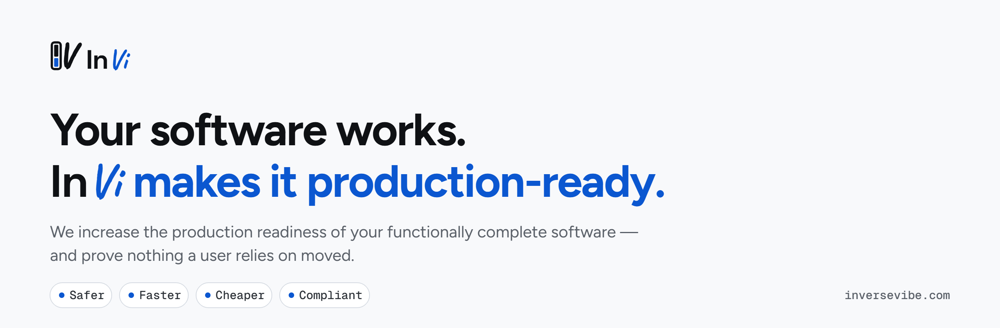

  <a href="https://inversevibe.com">
    <picture>
      <source media="(prefers-color-scheme: dark)" srcset="banner-dark.png" />
      <source media="(prefers-color-scheme: light)" srcset="banner-light.png" />
      
    </picture>
  </a>

  <a href="https://inversevibe.com"><b>Website</b></a> &nbsp;·&nbsp;
  <a href="https://app.inversevibe.com"><b>Get started</b></a> &nbsp;·&nbsp;
  <a href="https://inversevibe.com/benchmarks">Benchmarks</a> &nbsp;·&nbsp;
  <a href="https://inverse-vibe.github.io/OWASP-Benchmark-Comparator/leaderboard.html">OWASP leaderboard</a> &nbsp;·&nbsp;
  <a href="mailto:support@vinv.ai?subject=InVi%20%E2%80%94%20a%20demo">Book a demo</a>

---

### We increase the production readiness of your functionally complete software.

Your software is functionally complete. **InVi** makes it production-ready without changing what it does — safer, faster, cheaper and compliant, and it proves nothing a user relies on moved.

## The problem

**AI makes it work. Nobody makes it ready.** Agents ship working software fast; safety, speed, cost and compliance lag, and the gap grows.

| | |
|---|---|
| **45%** | of AI-written code samples carried a security flaw — *Veracode, 2025* |
| **30%+** | of Google's new code is AI-generated — *Alphabet, April 2025* |
| **90%** | of enterprise engineers will use AI code assistants by 2028 — *Gartner, 2024* |

## Why InVi

**One compiler for every quality, not a shelf of tools.**

- **An intelligent super-compiler.** It optimises your source code itself — what you ship comes out safer, faster, cheaper and compliant, with your business intent, policies and standards implemented, and verified.
- **Every objective at once.** Simultaneous multi-objective optimisation brings your application to a Pareto-optimal state: no field is bought at another's expense. Lower cost, and no separate optimisers fighting over the same code.
- **Yours to run, yours to own.** On-prem or in the cloud — with full ownership by you, if you want it. Your code, your data and every run stay where you put them.

## What improves

Functionality stays fixed. Everything else gets better.

| Field | What it means |
|---|---|
| **Safer** | No open path in. Every finding arrives with the input that proves it. |
| **Faster** | Key requests and journeys on time, measured before and after every fix. |
| **Cheaper** | Less compute and fewer calls per thousand requests, with nothing lost. |
| **Compliant** | Regulation, your brand guide and your PRD — every duty, screen and requirement checked. |

## How it works

Functionally complete? That is where InVi starts.

1. **Functionally complete** — it does what it should. Now make it production-ready.
2. **Dora maps it** — our reinforcement-learning engine explores every screen, request, function and branch.
3. **Baseline every behaviour** — what each input does, and the rules it must keep, confirmed on a second run.
4. **Search for issues** — detectors under each sub-metric find what to make safer, faster, cheaper and compliant.
5. **Fix, run, score, merge** — a fix goes to a person to merge only when its metric rises and every behaviour holds.

## Compliant three ways

- **Regulatory** — DPDP and SOC 2: every regulatory duty met, with its evidence. An audit-ready record, every release.
- **Brand** — every screen as the brand guide says. Every screen looks and reads as one product.
- **Product** — the app does what its documents say. The app does what the PRD promises.

## The proof — checkable in public

| | |
|---|---|
| **100%** | OWASP Benchmark, Java — first on both suites (Python 94.75%), ahead of CodeQL, Semgrep and SonarQube, with no model. [Leaderboard](https://inverse-vibe.github.io/OWASP-Benchmark-Comparator/leaderboard.html) · [code](https://github.com/Inverse-Vibe/OWASP-Benchmark-Comparator) |
| **74.6%** | of TensorFlow's branches reached with no tests written — twice the best published tool. [Details](https://inversevibe.com/benchmarks/tensorflow) |
| **11 of 17** | open-source fixes accepted or confirmed upstream — scikit-learn, Graphify, MemPalace and more. [The fixes](https://inversevibe.com/open-source) |

## It runs inside your walls

Code, data and every run stay on your servers. No outside model sees a line of it. Self-hosted, VPC or managed.

---

  <a href="https://app.inversevibe.com"><b>Get started</b></a> &nbsp;·&nbsp;
  <a href="mailto:support@vinv.ai?subject=InVi%20%E2%80%94%20a%20demo">Book a demo</a> &nbsp;·&nbsp;
  <a href="mailto:support@vinv.ai">support@vinv.ai</a> &nbsp;·&nbsp;
  <a href="https://inversevibe.com">inversevibe.com</a>

